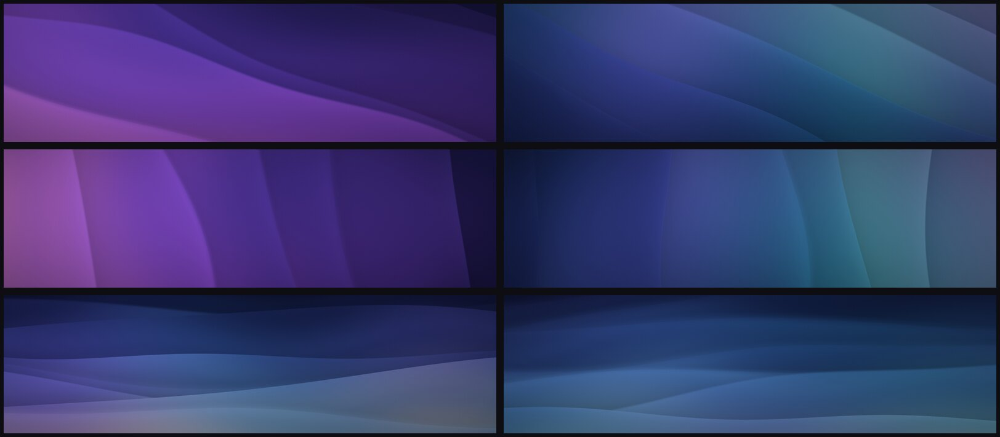

# soft-wallpapers

Generates soft, dark wallpapers in the spirit of the macOS ones: a few wide bands of neighbouring colours that melt
into each other, no hard edges.

## Use

    python3 wallgen.py <kind> <seed> <width> <height> <out.jpg>
    python3 wallgen.py curtains 10 5120 1440 curtains.jpg

- `kind`: `sweep` (diagonal bands), `curtains` (vertical folds), `dunes` (low horizontal waves) or `arcs`.
- `seed`: any integer. The same kind, seed and size always give the same picture, and the seed also picks the colour ramp.

Needs Python with `numpy` and `pillow`.

`render_all.py <start> <count>` renders the 20 picks I kept (9 sweeps, 7 curtains, 4 dunes) at 5120x1440 as
`soft-NN-kind.jpg` in the current folder.
